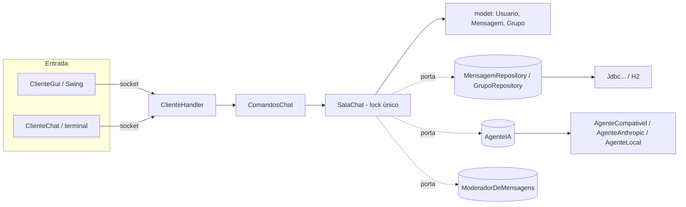

# Chat Multiusuário com Histórico

Projeto do 2º bimestre (Opção A) de Programação Orientada a Objetos — UniCesumar.
Servidor de chat em Java com sockets: vários clientes simultâneos, broadcast de mensagens
histórico persistido em banco via JDBC, **conversas privadas**, **grupos** e a assistente **UCI**
(agente de IA integrado por API).

## Requisitos

- JDK 17 ou superior
- Maven 3.8+

## Como compilar e testar

```bash
mvn test        # roda os testes (JUnit 5)
mvn package     # gera target/chat.jar (executável, com o driver do banco embutido)
```

## Como executar

Em um terminal, suba o servidor (porta padrão 5000):

```bash
java -jar target/chat.jar            # ou: java -jar target/chat.jar 6000
```

### Cliente com interface gráfica (recomendado)

Execute **uma vez para cada usuário** (cada janela é um cliente independente):

```bash
java -cp target/chat.jar br.unicesumar.chat.client.ClienteGui
```

| Tela | O que faz |
|---|---|
| **Início** | Informe servidor, porta e seu nome e clique em **Entrar no chat**. Erros (nome em uso, servidor fora do ar, porta inválida) aparecem na própria tela. |
| **Chat** | Mostra o histórico ao entrar, as mensagens em tempo real (cada pessoa com sua cor), a lista de quem está **online** e o campo para digitar (Enter envia). |
| **Abas** | **Geral**, uma aba por conversa privada (duplo clique em um usuário da lista) e uma por grupo. Aba com mensagem nova mostra um ponto (●). Ao abrir uma aba, o histórico dela é carregado. |
| **Barra lateral** | **Online** (clique duplo = conversa privada; a **UCI** aparece sempre) e **Meus grupos** com os botões **Criar / Entrar / Sair**. |
| **Início** (botão) | Volta à tela inicial **sem desconectar**. Lá aparece **Voltar ao chat (conectado como ...)** para retomar a conversa, e as mensagens recebidas nesse meio tempo estarão lá. |
| **Sair do chat** | Desconecta do servidor e volta à tela inicial. Digitar `/sair` faz o mesmo. |

**Visual:** mensagens em balões com avatar (as suas à direita, em azul; a UCI em roxo com selo "IA"),
mensagens seguidas da mesma pessoa agrupadas, avisos do sistema centralizados, abas em formato de pílula
com ponto azul quando há mensagem nova, lista de online com indicador de presença e campo de mensagem
com dica que muda conforme a conversa. Clique com o botão direito em um balão para **copiar** a mensagem.
O desenho fica em `Tema` (cores e fontes) e `Componentes` (campo, botões, abas); trocar a paleta é editar `Tema`.

O último servidor, porta e nome usados ficam salvos para a próxima vez. Se a conexão com o
servidor cair, o app volta ao início avisando.

### Cliente de console (alternativo)

```bash
java -cp target/chat.jar br.unicesumar.chat.client.ClienteChat                 # localhost:5000
java -cp target/chat.jar br.unicesumar.chat.client.ClienteChat 192.168.0.10 5000
```

O primeiro texto digitado é o seu nome (2 a 20 caracteres, sem espaços). Depois, cada linha
é uma mensagem. Comandos: `/usuarios`, `/ajuda`, `/sair` e os de privado/grupos/UCI abaixo.

## Privado, grupos e UCI

| Comando | O que faz |
|---|---|
| `/msg <usuario> <texto>` (ou `/p`) | Mensagem privada; só chega a quem está **online**. |
| `/grupo criar <nome>` | Cria um grupo (2 a 20 letras/números/`_`/`-`) e você entra nele. |
| `/grupo entrar <nome>` / `/grupo sair <nome>` | Entra / sai de um grupo (grupos são abertos). |
| `/grupo membros <nome>` | Lista os membros. `/grupos` lista os seus e os demais. |
| `/g <grupo> <texto>` | Mensagem para o grupo (só membros enviam e recebem). |
| `/historico <usuario>` ou `/historico #grupo` | Reenvia as últimas mensagens dessa conversa. |
| `@UCI <pergunta>` | Pergunta à UCI no chat geral ou em um grupo (todos veem a resposta). |
| `/msg UCI <pergunta>` | Conversa privada com a UCI (só você vê; ela lembra do contexto da conversa). |

Ao entrar, você recebe o histórico geral e o dos seus grupos. Na interface gráfica basta digitar
dentro da aba; o texto vira o comando certo automaticamente.

### Personalização e utilidades

| Comando / recurso | O que faz |
|---|---|
| `/status disponivel\|ocupado\|ausente` | Muda como você aparece na lista de online (bolinha colorida na janela). |
| `/buscar <texto>` | Procura nas últimas conversas **que você pode ver** (geral, seus grupos, seus privados). Máx. 20 resultados. |
| `/exportar [arquivo]` | Terminal: grava a conversa em `.txt`. Janela: botão **Mais → Exportar** (abre o seletor). |
| `/uci modo padrao\|formal\|descontraida\|professora` | Muda o estilo das respostas da UCI **só para você** (a janela lembra a escolha). |
| `/uci resumir [usuario\|#grupo]` | A UCI resume a conversa; só você vê a resposta. |
| `/uci traduzir <idioma> <texto>` / `/uci explicar <texto>` | Utilidades da UCI (resposta privada). |
| `/grupo remover <grupo> <usuario>` | O criador do grupo remove um membro. |
| Moderação | Palavras ofensivas da lista `ModeradorPorLista` viram `****` (porta `ModeradorDeMensagens`). |

Na janela (**Mais → Aparência**): tema claro/escuro, tamanho da fonte, modo compacto, cor do seu nome,
som de aviso, silenciar conversas, contador de não lidas e aviso "fulano está digitando…".
As preferências ficam salvas no computador (`java.util.prefs`, classe `Preferencias`).
Linhas de controle novas do protocolo (só para clientes `/modo gui`): `@@STATUS|nome=status,...` e
`@@DIGITANDO|quem|conversa`.

### UCI (agente de IA)

#### Passo a passo: conectar a IA ao projeto (Groq, grátis, sem instalar nada)

O projeto já vem com o arquivo **`uci.properties`** na raiz (ao lado do `pom.xml`), com a chave em branco.
Só quem roda o **servidor** precisa disso; os outros computadores só conectam pelo IP.

1. Crie uma conta gratuita em **console.groq.com** e, no menu **API Keys**, clique em *Create API Key*.
   Copie a chave (começa com `gsk_`); ela só aparece uma vez.
2. Abra o `uci.properties` e troque `COLE-SUA-CHAVE-AQUI` pela chave, sem aspas e sem espaços:
   ```
   UCI_PROVIDER=groq
   UCI_API_KEY=gsk_sua_chave_aqui
   UCI_MODEL=openai/gpt-oss-20b
   ```
3. Suba o servidor **a partir da pasta onde está o `uci.properties`** (o arquivo é lido da pasta atual):
   ```
   mvn package
   java -jar target/chat.jar
   ```
   (ou, na IDE, rode `Servidor` com a pasta do projeto como diretório de trabalho).
4. Confira o console do servidor: deve aparecer `UCI usando: ...Groq...` e depois
   `Teste da UCI: FUNCIONOU`. Se disser `MODO LOCAL` ou `FALHOU`, veja a tabela abaixo.
5. Abra o cliente (janela ou terminal) e use: `@UCI sua pergunta` (geral/grupo) ou `/msg UCI sua pergunta` (privado).

| Sintoma no log | Causa provável |
|---|---|
| `MODO LOCAL` | O `uci.properties` não foi achado (servidor iniciado em outra pasta) ou a chave ficou em branco. |
| `FALHOU ... 401` | Chave errada/expirada: gere outra. |
| `FALHOU ... 404 / model_not_found` | Nome do modelo mudou: o log lista os disponíveis; copie um para `UCI_MODEL`. |
| `FALHOU ... 429` | Limite gratuito atingido: espere um pouco. |
| `FALHOU` por rede | Sem internet ou rede da faculdade bloqueando `api.groq.com`; use o Ollama (abaixo) ou outra rede. |

> **Segurança:** o `uci.properties` está no `.gitignore`. **Nunca** envie o arquivo com a chave para o Git,
> grupo de WhatsApp ou professor; antes de compartilhar o projeto, apague a chave. Se vazar, revogue a
> chave no painel do Groq e gere outra.

#### Detalhes e alternativas

A UCI escolhe o agente ao subir o servidor (o log mostra qual), sempre por **variáveis de ambiente**
(chaves nunca ficam no código nem no Git). Ordem de escolha: `UCI_PROVIDER`/`UCI_API_URL` →
`ANTHROPIC_API_KEY` → modo local (offline, por palavras-chave).

**Opção grátis e leve: Ollama (roda no seu computador, sem conta, sem chave, sem custo)**

1. Instale o Ollama (ollama.com) e baixe um modelo pequeno (~1,3 GB, roda sem placa de vídeo):
   `ollama pull llama3.2:1b`
2. Suba o servidor do chat com:
   - CMD: `set UCI_PROVIDER=ollama` e depois `java -jar target/chat.jar`
   - PowerShell: `$env:UCI_PROVIDER="ollama"` e depois `java -jar target/chat.jar`
   - Linux/Mac: `UCI_PROVIDER=ollama java -jar target/chat.jar`

As perguntas não saem do seu computador. A primeira resposta demora mais (o modelo carrega na memória).

**Opção grátis na nuvem (precisa de uma chave gratuita):** `UCI_PROVIDER=groq` com `UCI_API_KEY=...`.
Para outro serviço compatível com o formato OpenAI (OpenRouter, Gemini etc.) use
`UCI_API_URL=<endereço base>`, `UCI_MODEL=<modelo>` e `UCI_API_KEY=<chave>`. Os nomes de modelos e os
limites gratuitos mudam com o tempo: confira no site do serviço.

**Configurando por arquivo (recomendado no Windows/IDE):** em vez de variáveis de ambiente, copie
`uci.properties.exemplo` para `uci.properties` **na pasta de onde você roda o servidor** e descomente a
opção desejada (por exemplo `UCI_PROVIDER=ollama`). Variáveis de ambiente, se existirem, têm prioridade.

**Como saber se funcionou:** ao subir, o log diz `UCI usando: ...` e, em seguida, `Teste da UCI:
FUNCIONOU` ou `FALHOU` com o motivo (Ollama desligado, chave inválida...). `MODO LOCAL` significa que
nenhuma configuração chegou ao servidor.

**Anthropic (opcional, pago por uso):** `ANTHROPIC_API_KEY` (e, se quiser, `UCI_MODEL`, `ANTHROPIC_BASE_URL`).

Se o agente falhar (Ollama desligado, chave inválida, sem internet), a UCI avisa na conversa com uma
mensagem simples e o detalhe técnico vai só para o log do servidor. Configuração inválida faz o
servidor subir em modo local, com um aviso no log.

> **Privacidade:** com serviços na nuvem, as perguntas à UCI são enviadas ao provedor; com o Ollama
> ficam na sua máquina. Em qualquer caso, mensagens privadas e de grupo ficam **gravadas em texto puro**
> no banco do servidor (sem criptografia).

## Banco de dados

- Padrão: **H2** em arquivo (`./data/chat.mv.db`), sem instalar nada.
- As tabelas (`mensagem`, `grupo`, `grupo_membro`) são criadas automaticamente na subida do servidor a partir de
  [`src/main/resources/schema.sql`](src/main/resources/schema.sql) (esse é o script de criação
  das tabelas pedido nos entregáveis). Bancos criados pela versão anterior são migrados sozinhos
  (colunas `tipo` e `destino`; as mensagens antigas viram "geral").
- Para usar outro banco, defina variáveis de ambiente e adicione o driver no `pom.xml`:

  ```bash
  CHAT_DB_URL=jdbc:postgresql://localhost:5432/chat CHAT_DB_USER=postgres CHAT_DB_PASSWORD=senha java -jar target/chat.jar
  ```

  No MySQL/MariaDB troque a coluna `id` no `schema.sql` por `BIGINT AUTO_INCREMENT PRIMARY KEY`.

## Estrutura

```
src/main/java/br/unicesumar/chat/
├── model/         Usuario, Mensagem, Grupo, StatusUsuario              (entidades e regras de negócio)
├── persistence/   MensagemRepository, GrupoRepository (interfaces),
│                  JdbcMensagemRepository, JdbcGrupoRepository (JDBC), GrupoRepositoryMemoria,
│                  ConexaoFactory, PersistenciaException
├── protocolo/     Protocolo, Evento, Interpretador       (formato das linhas, num só lugar)
├── agente/        AgenteIA (interface), AgenteCompativel (Ollama/Groq/OpenAI-like), AgenteAnthropic, AgenteLocal (offline),
│                  ServicoUci (threads próprias), Personalidade, Json, Turno, AgenteException
├── server/        Servidor, ClienteHandler, SalaChat, ComandosChat, RegistroGrupos,
│                  Destinatario, ChatException, LogComandos, ModeradorDeMensagens, ModeradorPorLista
└── client/        ClienteGui (main), AplicacaoChat (controlador), TelaInicio, TelaChat,
                   PainelConversa, Conversa, Tema, Preferencias, DialogoPreferencias, Exportacao, ConexaoChat (rede, sem Swing), ClienteChat (console)
src/main/resources/schema.sql
sql/criar_tabelas.sql   mesmo script, na pasta exigida pela entrega
AGENTS.md              regras para assistentes de IA
logs/chat-comandos.log  gerado em execução (log de comandos)
src/test/java/...  testes JUnit 5
RELATORIO.md       relatório de arquitetura e concorrência
```

## Terminal e log de comandos

O cliente de terminal (`ClienteChat`) e o gráfico falam o mesmo protocolo, mas há diferenças que
explicam a maior parte dos "erros" vistos só no terminal:

| Situação | Terminal | GUI |
|---|---|---|
| Texto sem `/` | vai sempre para a **sala geral** | vai para a aba aberta (privado/grupo) |
| Responder em privado/grupo | `/msg <usuario> <texto>` ou `/g <grupo> <texto>` | só digitar na aba |
| Acentos no nome (ex.: José) | o cliente converte da codificação do terminal para UTF-8 | UTF-8 nativo |
| Comando errado | linha `! motivo` na tela | mensagem na tela |

Todo comando (e toda mensagem recusada) passa por `ComandosChat`, que grava em `LogComandos`:

```
2026-11-03 21:10:05 AVISO [ana] "/grupo entrar xyz" -> O grupo #xyz não existe. Use /grupos para ver os existentes.
2026-11-03 21:10:09 INFO  [ana] "/grupos" -> ok
```

O arquivo fica em `logs/chat-comandos.log` (pasta de onde o servidor foi iniciado) e também aparece
no console do servidor. O conteúdo de mensagens comuns nunca é gravado. Erros inesperados viram
`ERRO` com a pilha e o usuário recebe `! Erro interno ... registrado no log`, sem perder a conexão.

## Arquitetura e linguagem ubíqua



| Termo | Classe | Tipo (DDD) |
|---|---|---|
| Usuário | `Usuario` | entidade (igualdade pelo nome) |
| Mensagem | `Mensagem` | objeto de valor imutável |
| Grupo | `Grupo` | entidade |
| Sala | `SalaChat` | serviço/raiz que protege o estado compartilhado |
| Comando | `ComandosChat` | serviço de aplicação |
| Histórico | `MensagemRepository` | porta (repositório) |
| UCI | `AgenteIA` / `ServicoUci` | porta e serviço |
| Registro de comandos | `LogComandos` | adaptador de saída (log) |
| Status | `StatusUsuario` | objeto de valor (enum) |
| Personalidade da UCI | `Personalidade` | objeto de valor (enum) |
| Moderação | `ModeradorDeMensagens` / `ModeradorPorLista` | porta e adaptador |
| Preferências | `Preferencias` | adaptador de saída (`java.util.prefs`) |

## Revisão de concorrência

- Estado compartilhado: lista `clientes` e grupos, sempre sob `synchronized (clientes)` em `SalaChat`.
- Cada cliente tem fila de saída própria (`BlockingQueue`) e thread escritora: um cliente lento não trava a sala.
- Chamadas à IA rodam fora do lock (`ServicoUci`); só a entrega da resposta toma o lock.
- Sem deadlock: há um único lock; `enviar` nunca bloqueia.
- Status, personalidade da UCI, "digitando" e `/buscar` seguem a mesma regra (sob o lock). `SalaChatConcorrenciaTest` roda 12 usuários em paralelo (`ExecutorService` + `CountDownLatch` + `awaitTermination`, `@RepeatedTest(10)`) e confere que ninguém perde mensagem e que todos veem a mesma ordem.

## Uso de IA no desenvolvimento

O código foi desenvolvido com apoio de IA (Claude) e revisado/testado pelo grupo. Veja `AGENTS.md`.

## Roteiro sugerido para o vídeo (3+ clientes)

1. Mostrar o servidor subindo e o `schema.sql`.
2. Abrir 3 janelas do `ClienteGui` (ana, bia, caio), lado a lado, e trocar mensagens: todos recebem.
3. Tentar entrar com um nome repetido (`ANA`) e mostrar a mensagem de erro na tela inicial.
4. Na janela da ana, clicar em **Início** (sem sair) e depois em **Voltar ao chat**.
5. Fechar a janela da bia abruptamente (no X): os outros continuam normalmente e veem "bia saiu do chat".
6. Abrir um novo cliente (dani) e mostrar o **histórico** recebido ao conectar.
7. Clicar em **Sair do chat** em uma janela.
8. Criar um grupo (`estudo`) na ana, entrar com a bia, trocar mensagens; o caio **não** vê nada.
9. Conversa privada ana ↔ bia (duplo clique na lista); mostrar que o caio não recebe.
10. Perguntar à UCI no privado e com `@UCI` no geral/grupo (e mostrar o "UCI está digitando…").
11. Mostrar rapidamente o resultado de `mvn test`.

## Mapeamento com os critérios de avaliação

| Critério | Onde está |
|---|---|
| Multithreading (1,3) | `Servidor.aceitarConexoes()` cria uma thread por `ClienteHandler` |
| Broadcast sincronizado (1,2) | `SalaChat` (`synchronizedList` + `synchronized (clientes)`) |
| Persistência JDBC (1,0) | `JdbcMensagemRepository`, `schema.sql` |
| Pacotes e responsabilidades (0,5) | `model`, `persistence`, `server`, `client` |
| Testes unitários (0,5) | `src/test/java` (modelo, sala com fakes, repositório em H2) |
| Organização e relatório (0,5) | este README e `RELATORIO.md` |
| Extra: grupos, privado e UCI | `SalaChat`, `RegistroGrupos`, `ComandosChat`, `agente/*` |
| Extra: interface gráfica | `ClienteGui`, `AplicacaoChat`, `TelaInicio`, `TelaChat` |
